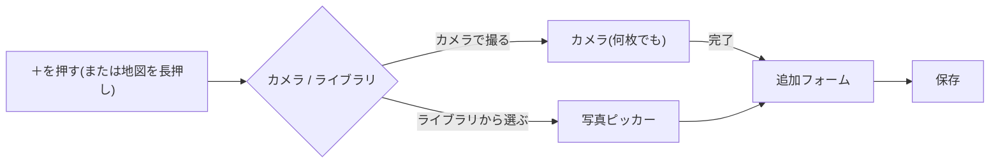

# 画面仕様: アプリ内カメラ

- 読み手: 実装者・確認者(本人・エージェント)
- 目的: 「+」からカメラで撮る流れと、カメラ画面の挙動を定義する
- 要件: [0008](../requirements/0008-in-app-camera.md)。設計の理由: [ADR 0020](../adr/0020-in-app-camera.md)
- 確認: シミュレーターにはカメラが無いため、**実機で未確認**(許可・撮影・位置・ライブラリへの保存)

## 1. 流れ

## 2. カメラ画面

| 項目 | 挙動 |
|---|---|
| 上 | 左に閉じる(撮った写真は捨てる)、右にフラッシュのオン/オフ(インカメラでは出ない)。完了ボタンを右上に置く案もある |
| 中央 | プレビュー。タップでピントと露出をその点に合わせる(黄色の枠が1秒出る)。ピンチでズーム(上限は10倍まで) |
| 倍率 | 使える背面のレンズに応じて、超広角 0.5・広角 1・望遠(3 など)を切り替える。2つ以上あるときだけ出る |
| 下 | シャッター、撮った枚数(最後の写真のサムネイルと枚数、または枚数だけ)、完了、インカメラ/アウトカメラの切り替え |
| 完了 | 撮った写真をまとめて追加フォームへ渡す。撮影中の写真が残っているあいだは押せない |

## 3. 撮ったあと

- 日時は撮影した時刻。位置は撮った瞬間の現在地(使用中のみの許可)。地図の長押しで場所を指定していれば、そちらを優先する。
- 位置が求まらなかった写真(許可が無い・数秒で求まらない)は、追加フォームで地図に置くまで保存できない。
- 撮った写真は、端末の写真ライブラリにも保存する(「追加のみ」の許可)。許可されなくても、アプリ内には保存する。
- カメラの許可が無いときは、案内と「設定を開く」を出す。
